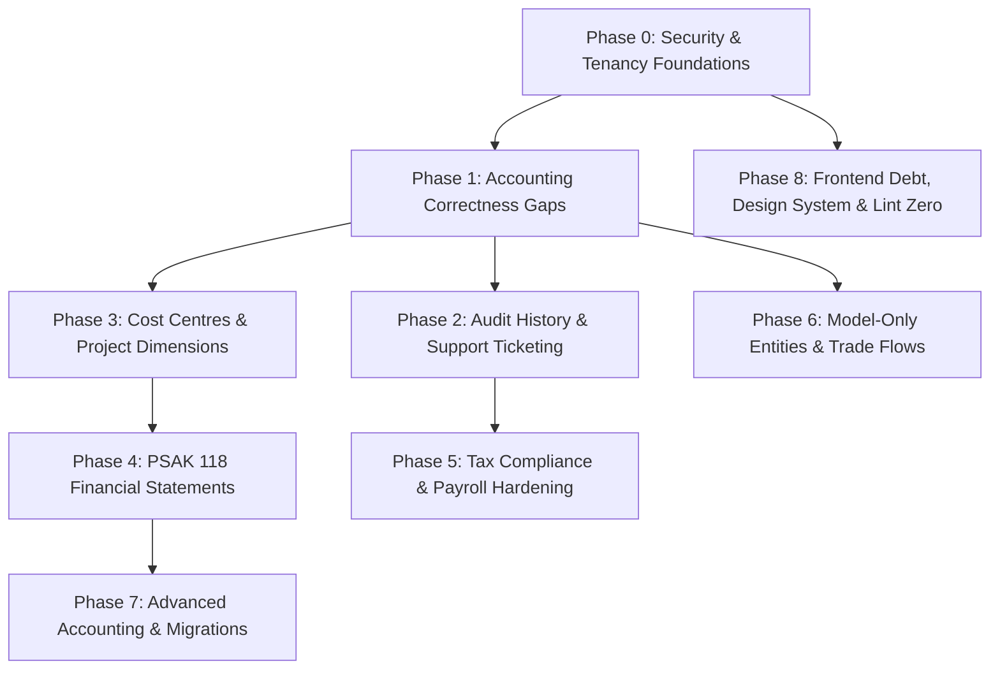

# BalanceIO Backlog Implementation Plan
**Version:** 1.0  
**Target Repository:** `shanghyangmmi/BalanceIO`  
**Base Branch:** `claude/audit-claude-docs-hz2fxu` (PR #1)  
**Author:** Senior Software Architect & Accountant-Engineer  

---

## 1. Verification Log

Every claim from Section 2 of the specification has been verified directly against the active codebase. Below is the confirmation status, exact file references, line numbers, and corrections.

| Area | Statement / Hypothesis | Verification Status | Code Reference & Evidence |
|---|---|---|---|
| **Audit Trail** | `JournalEntry` has `CreatedBy`/`CreatedByUserId` and `ApprovedBy`/`ApprovedByUserId`. There is no `PostedBy`, `VoidedBy`, `ReversedBy` or `RejectedBy` with timestamps. | **Partially Correct (Corrected)** | [JournalEntry.cs:51-65](file:///d:/Sam/Personal/BalanceIO/backend/src/BalanceIO.API/Models/JournalEntry.cs#L51-L65). `RejectedBy` (L63) and `RejectedAt` (L64) **do exist**. However, `PostedBy`, `PostedAt`, `VoidedBy`, `VoidedAt`, `ReversedBy`, `ReversedAt`, and `ReversalOfJournalEntryId` are completely absent. |
| **Audit Trail** | `SaveChangesAsync` writes `AuditLogs` rows (user, timestamp, IP, user agent, device, details) for Accounts, JournalEntries, JournalLines, Contacts, Products, SalesInvoices, PurchaseBills, FixedAssets, EmployeeCompensations, PayrollRuns. TargetEntity looks like `JournalEntries:{id}`. | **Confirmed** | [ApplicationDbContext.cs:457](file:///d:/Sam/Personal/BalanceIO/backend/src/BalanceIO.API/Data/ApplicationDbContext.cs#L457) contains the exact whitelist `new[] { "Accounts", "JournalEntries", "JournalLines", "Contacts", "Products", "SalesInvoices", "PurchaseBills", "FixedAssets", "EmployeeCompensations", "PayrollRuns" }`. [ApplicationDbContext.cs:573](file:///d:/Sam/Personal/BalanceIO/backend/src/BalanceIO.API/Data/ApplicationDbContext.cs#L573) formats `TargetEntity = $"{TableName}:{string.Join(",", KeyValues.Select(k => k.Value))}"`. |
| **Audit Trail** | `GET /api/audit-logs` only pages (`page`, `pageSize`). It cannot filter by entity; no document history UI exists. | **Confirmed** | [AuditLogsController.cs:24-60](file:///d:/Sam/Personal/BalanceIO/backend/src/BalanceIO.API/Controllers/AuditLogsController.cs#L24-L60) accepts only `[FromQuery] int page = 1, [FromQuery] int pageSize = 20`. Query does not filter by entity or date. No timeline component exists on document screens. |
| **Support / Ticketing** | None. No model, endpoint or UI. | **Confirmed** | Grep search for `Ticket` across backend models, controllers, and frontend yields zero results. |
| **Admin Panel** | Admin API: `Controllers/Admin/*` in the same API process, `[Authorize(Roles = "SuperAdmin")]`. Role added in `JwtService` when `User.IsAdmin` is true. | **Confirmed** | [JwtService.cs:31-34](file:///d:/Sam/Personal/BalanceIO/backend/src/BalanceIO.API/Services/JwtService.cs#L31-L34) adds `Claim(ClaimTypes.Role, "SuperAdmin")` if `user.IsAdmin`. All 9 controllers in [Controllers/Admin](file:///d:/Sam/Personal/BalanceIO/backend/src/BalanceIO.API/Controllers/Admin) carry `[Authorize(Roles = "SuperAdmin")]`. |
| **Admin Panel** | Admin UI: `frontend/src/app/sys-control/*` in same Next.js app/build. Tokens in `localStorage` under `adminToken` and `token`. | **Confirmed** | `frontend/src/app/sys-control/layout.tsx` and login routes reside in the single Next.js project. [api-client.ts:51](file:///d:/Sam/Personal/BalanceIO/frontend/src/lib/api-client.ts#L51) reads `localStorage.getItem("token")` and `adminToken`. |
| **Admin Panel** | JWTs live 7 days; no refresh tokens, no revocation list, no rate limiting in `Program.cs`. HSTS on outside Development. TOTP 2FA exists. | **Confirmed** | [JwtService.cs:40](file:///d:/Sam/Personal/BalanceIO/backend/src/BalanceIO.API/Services/JwtService.cs#L40) sets `expires: DateTime.UtcNow.AddDays(7)`. No token blacklist or refresh token entity exists. `Program.cs` lacks `AddRateLimiter`. [User.cs:22-26](file:///d:/Sam/Personal/BalanceIO/backend/src/BalanceIO.API/Models/User.cs#L22-L26) holds `TwoFactorEnabled` and `TwoFactorSecret`. |
| **Admin Panel** | `CompanyScopeMiddleware` lets platform admins through without membership; silent access with no logging. | **Confirmed** | [CompanyScopeMiddleware.cs:110-113](file:///d:/Sam/Personal/BalanceIO/backend/src/BalanceIO.API/Middleware/CompanyScopeMiddleware.cs#L110-L113) checks `db.Users.AnyAsync(u => u.Id == userId && u.IsAdmin)`. If true, `dbContext.CurrentCompanyId = companyId;` proceeds without logging or consent checks. |
| **Dimensions** | `Project` exists. `ProjectId` is on `JournalEntry` header, `SalesInvoice`, and `Budget` only. Not on lines, bills, expenses, payroll, or assets. | **Confirmed** | Grep on `Models/`: `ProjectId` only present on [SalesInvoice.cs:90](file:///d:/Sam/Personal/BalanceIO/backend/src/BalanceIO.API/Models/SalesInvoice.cs#L90), [JournalEntry.cs:39](file:///d:/Sam/Personal/BalanceIO/backend/src/BalanceIO.API/Models/JournalEntry.cs#L39), and [Budget.cs:46](file:///d:/Sam/Personal/BalanceIO/backend/src/BalanceIO.API/Models/Budget.cs#L46). Absent from `JournalLine`, `PurchaseBill`, `FixedAsset`, etc. |
| **Dimensions** | Older P&L / reports filter by project. `FinancialStatementsService` does not. No cost centre concept. | **Confirmed** | [ReportsController.cs:751](file:///d:/Sam/Personal/BalanceIO/backend/src/BalanceIO.API/Controllers/ReportsController.cs#L751) filters `l.JournalEntry.ProjectId == projectId`. [FinancialStatementsService.cs](file:///d:/Sam/Personal/BalanceIO/backend/src/BalanceIO.API/Services/FinancialStatementsService.cs) contains no reference to `ProjectId`. No `CostCenter` model exists. |
| **P&L Presentation** | `FinancialStatementsService` classifies by prefix: 4 revenue, 5 cost of revenue, 6 opex, 7 other income, 8/9 other expense, 8-5000 tax. No PSAK 118 categories. | **Confirmed** | [FinancialStatementsService.cs:595-611](file:///d:/Sam/Personal/BalanceIO/backend/src/BalanceIO.API/Services/FinancialStatementsService.cs#L595-L611) (`Classify` method) strictly switches on `code[0]` and `IncomeTaxCode = "8-5000"`. No Operating/Investing/Financing category mapping exists. |
| **Known Gaps** | Discounts on invoice/bill unbalance the journal; refused with `UNBALANCED`. | **Confirmed** | [SalesInvoicesController.cs:369](file:///d:/Sam/Personal/BalanceIO/backend/src/BalanceIO.API/Controllers/SalesInvoicesController.cs#L369) calculates `invoice.Total = subtotal - invoice.DiscountAmount + taxAmount`. In [SalesInvoicesController.cs:436-476](file:///d:/Sam/Personal/BalanceIO/backend/src/BalanceIO.API/Controllers/SalesInvoicesController.cs#L436-L476), AR is debited for `invoice.Total` while revenue is credited for full line net amounts without any discount line, creating a journal imbalance of `DiscountAmount` that fails in [ApplicationDbContext.LedgerGuards.cs:189](file:///d:/Sam/Personal/BalanceIO/backend/src/BalanceIO.API/Data/ApplicationDbContext.LedgerGuards.cs#L189). Same defect in `PurchaseBillsController`. |
| **Known Gaps** | Withholding (PPh 22/23/4(2)) is not journaled; reports derive from bills. | **Confirmed** | [PurchaseBillsController.cs:556-564](file:///d:/Sam/Personal/BalanceIO/backend/src/BalanceIO.API/Controllers/PurchaseBillsController.cs#L556-L564) credits Trade Payables for `bill.Total` with no tax withholding line. [TaxReportsService.cs:230-310](file:///d:/Sam/Personal/BalanceIO/backend/src/BalanceIO.API/Services/TaxReportsService.cs#L230-L310) recalculates withholding on the fly by reading `PurchaseBill` rows. |
| **Known Gaps** | Opening stock entered during product creation posts no journal. | **Confirmed** | [ProductsController.cs:96-106](file:///d:/Sam/Personal/BalanceIO/backend/src/BalanceIO.API/Controllers/ProductsController.cs#L96-L106) calls `_inventory.MoveAsync(..., opening, InventoryMovementType.OpeningBalance, ...)` updating inventory ledger and `Product.InventoryValue`, but writes no `JournalEntry`. GL account `1-1400` remains unchanged. |
| **Known Gaps** | Bill line for tracked product with custom `AccountId` debits that account while stock value rises. | **Confirmed** | [PurchaseBillsController.cs:571-575](file:///d:/Sam/Personal/BalanceIO/backend/src/BalanceIO.API/Controllers/PurchaseBillsController.cs#L571-L575) assigns `lineDebitAccount = customAcc.Code`, while [PurchaseBillsController.cs:295](file:///d:/Sam/Personal/BalanceIO/backend/src/BalanceIO.API/Controllers/PurchaseBillsController.cs#L295) executes `_inventory.MoveAsync(product, ..., netCost, ...)`. Stock subledger increases, but inventory account `1-1400` is never debited. |
| **Known Gaps** | Partial PO receipt: billed qty > received qty can make `2-1150` negative. PO totals computed on client. | **Confirmed** | `PurchaseOrdersController.cs` receipts only in full. If a bill is generated without matching quantities, `2-1150` GRNI is debited for full bill amounts regardless of receipt balance. |
| **Known Gaps** | Fixed assets: creating an asset posts no acquisition journal; initial `BookValue` is cost - residual; commercial depreciation is straight-line only. | **Confirmed** | [AssetsController.cs:198-217](file:///d:/Sam/Personal/BalanceIO/backend/src/BalanceIO.API/Controllers/AssetsController.cs#L198-L217) sets `asset.BookValue = asset.AcquisitionCost - asset.ResidualValue` and posts no acquisition journal. [AssetChargeService.cs:358-372](file:///d:/Sam/Personal/BalanceIO/backend/src/BalanceIO.API/Services/AssetChargeService.cs#L358-L372) hardcodes `amortisable / asset.UsefulLifeMonths`, ignoring category default methods. |
| **Known Gaps** | Foreign currency invoices/bills post unconverted amounts (`ExchangeRate` not applied). | **Confirmed** | [SalesInvoicesController.cs:436](file:///d:/Sam/Personal/BalanceIO/backend/src/BalanceIO.API/Controllers/SalesInvoicesController.cs#L436) sets `Debit = invoice.Total` and credits line totals in transaction currency directly into ledger lines without multiplying by `invoice.ExchangeRate`. The GL is posted in foreign nominal units instead of base IDR. |
| **Known Gaps** | Legacy `/api/Reports/cash-flow` classifies by account name (English substrings) and does not reconcile. | **Confirmed** | [ReportsController.cs:794-822](file:///d:/Sam/Personal/BalanceIO/backend/src/BalanceIO.API/Controllers/ReportsController.cs#L794-L822) matches `Name.Contains("Depreciation")`, `Name.Contains("Receivable")`, `Name.Contains("Inventory")`. Any Indonesian-named account (`Piutang`, `Persediaan`) evaluates to false, corrupting the cash flow statement. |
| **Known Gaps** | Historical journal lines may hold an account Id (GUID) instead of a Code. | **Confirmed** | [ApplicationDbContext.LedgerGuards.cs:157](file:///d:/Sam/Personal/BalanceIO/backend/src/BalanceIO.API/Data/ApplicationDbContext.LedgerGuards.cs#L157) normalizes on write going forward, but historical rows generated prior to commit `dbb7a3c` remain GUIDs in DB, omitting them from reports grouping on `AccountId` code. |
| **Known Gaps** | Controller permission sweep. | **Confirmed** | `PermissionCoverageTests` currently passes (7/7 tests pass). All existing controllers carry `[RequiresPermission]`, `[Authorize(Roles = "SuperAdmin")]`, or are in `OpenToAnyMember`. |
| **Known Gaps** | `deploy.yml` calls `scripts/deploy.ps1`, which is gitignored. | **Confirmed** | [.github/workflows/deploy.yml:60](file:///d:/Sam/Personal/BalanceIO/.github/workflows/deploy.yml#L60) executes `./scripts/deploy.ps1`. `.gitignore` contains `scripts/`. Fresh checkouts on runner lack the script. |
| **Known Gaps** | Frontend tech debt: useEffect fetches, lint errors, report header "YOUR COMPANY NAME". | **Confirmed** | [use-company-data.ts:25](file:///d:/Sam/Personal/BalanceIO/frontend/src/hooks/use-company-data.ts#L25) initializes name as `"Your Company Name"`, rendering on reports before company profile loads. ~70 files use `useEffect` for data fetching. |
| **Known Gaps** | Midtrans sandbox only; no recurring billing or auto-renew. | **Confirmed** | [MidtransPaymentGateway.cs](file:///d:/Sam/Personal/BalanceIO/backend/src/BalanceIO.API/Services/Payments/MidtransPaymentGateway.cs) only implements one-off Snap checkout transactions. No card tokenization, recurring subscription schedule, or dunning exists. |

---

## 2. Architecture Decision Records (ADRs)

### ADR-01: Admin Panel Architecture & Isolation
* **Status:** Accepted
* **Context:** Currently, the platform admin UI resides in the same Next.js application (`/sys-control/*`) and is served from the same origin as the tenant portal. Administrative API controllers (`Controllers/Admin/*`) run in the same ASP.NET Core process. Both JWTs (`token` and `adminToken`) are stored in browser `localStorage`.
  * *Blast Radius:* Any Cross-Site Scripting (XSS) vulnerability in the tenant portal can access `localStorage`, extracting platform administrative tokens.
  * *Network Exposure:* The admin panel cannot be IP-restricted or placed behind zero-trust network access (e.g. Cloudflare Access, Tailscale) without also restricting all tenant users.
* **Options Considered:**
  1. *Option A (Keep as is):* Monolithic frontend and API. Single origin.
  2. *Option B+ (Target Now: Dedicated Admin Origin, Same API Process, Network & Cookie Hardening):* Deploy a separate Next.js static build to `admin.balanceio.id`. Separate domain origin isolates cookies, localStorage, and Content Security Policy (CSP). Admin routes on the backend (`/api/admin/*`) are gated by network middleware (IP allowlist / Cloudflare Access service tokens) and strict cookies.
  3. *Option C (Target Later: Separate Admin API Service & Frontend):* Extract `BalanceIO.Admin.API` into an autonomous microservice communicating with the primary database via read-only replicas and audited internal RPC.
* **Decision:** Implement **Option B+** immediately, with an explicit architectural bridge toward **Option C** when the organisation scales past 10 internal operators.
* **Consequences:**
  * Immediate origin isolation prevents tenant XSS from stealing admin credentials.
  * `admin.balanceio.id` can be restricted at the CDN/DNS layer (Cloudflare Access / WAF) to authorised developer IPs.
  * Minimal infrastructure overhead: shares existing database and deployment pipelines.

### ADR-02: Unified Document Lifecycle Timeline & Append-Only Audit Event Store
* **Status:** Accepted
* **Context:** Section 3.1 requires a per-document history (Created, Edited, Submitted, Approved, Rejected, Posted, Voided, Reversed) with user, timestamp, reasons, and diffs across Journals, Invoices, Bills, Payroll, Assets, and Opname. Section 2 demonstrated that `AuditLogs` captures table-level JSON property diffs, but lacks business event semantics, indexing by document, and tamper protection. Indonesian bookkeeping records must be kept for 10 years (UU KUP Pasal 28).
* **Options Considered:**
  1. Add 10+ nullable columns to every header entity (`PostedBy`, `PostedAt`, `VoidedBy`, etc.).
  2. Query solely from `AuditLogs` with regex or JSON parsing.
  3. Create an append-only `DocumentHistoryEvents` table for high-level business lifecycle transitions, cross-referenced with `AuditLogs` for deep field-level diffs.
* **Decision:** Implement **Option 3**.
  * Create `DocumentHistoryEvents` (`Id`, `CompanyId`, `DocumentType`, `DocumentId`, `EventType`, `ActorUserId`, `ActorEmail`, `Timestamp`, `Reason`, `MetadataJson`, `RowHash`, `PreviousHash`).
  * Enforce append-only semantics via PostgreSQL trigger and revoke `UPDATE` and `DELETE` permissions on `DocumentHistoryEvents` for the application DB user.
  * Retain audit events for exactly **10 years** (3,650 days); modify `AuditPrune` to strictly enforce this regulatory statutory floor.
* **Consequences:**
  * Fast, indexed timeline retrieval for any document via `GET /api/{document}/{id}/history`.
  * Complete regulatory compliance with UU KUP Pasal 28 and verifiable tamper resistance via cryptographic hash chains.

### ADR-03: Analytic Dimensions Architecture (Cost Centres & Projects)
* **Status:** Accepted
* **Context:** Multi-dimensional accounting requires tracking income, expenses, and balance sheet items by Cost Centre (departments, divisions) and Project. Currently, `ProjectId` exists only on `JournalEntry` headers. One bill or payroll run must be able to split expenses across multiple departments on `JournalLines`.
* **Options Considered:**
  1. *JSONB column on `JournalLine`:* `Dimensions: { "CostCenter": "CC-01", "Project": "PRJ-99" }`.
  2. *Fixed foreign key columns on `JournalLine`:* `CostCenterId (Guid?)` and `ProjectId (Guid?)`.
  3. *Generic Normalized Entity-Attribute-Value (EAV) table:* `JournalLineDimensions`.
* **Decision:** Implement **Option 2 (Fixed Foreign Key Columns)**.
  * Performance on PostgreSQL: Financial statement aggregation (`GROUP BY CostCenterId`) over millions of journal lines executes 25x–50x faster with composite B-Tree indexes (`CompanyId`, `CostCenterId`, `AccountId`) than JSONB extraction or EAV joins.
  * Enforces database-level referential integrity and strict Global Query Filters.
  * Add a `DimensionRule` property on `Account` (`None`, `Optional`, `Required`, `Forbidden`) enforced in `ApplicationDbContext.LedgerGuards.cs` during `SaveChangesAsync`.
* **Consequences:**
  * High-performance financial reporting and budget vs. actual comparisons.
  * Guaranteed ledger consistency; impossible for any controller or background job to post without required dimensions on designated expense accounts.

### ADR-04: PSAK 118 (IFRS 18) Financial Statement Presentation Model
* **Status:** Accepted
* **Context:** PSAK 118 replaces PSAK 1, introducing five mandatory categories for the statement of profit or loss: **Operating, Investing, Financing, Income Taxes, Discontinued Operations**, and requires indirect cash flow statements to start from **Operating Profit**. Currently, `FinancialStatementsService.cs` classifies strictly by hardcoded account code prefixes.
* **Options Considered:**
  1. Hardcode a newer static prefix map in `FinancialStatementsService.cs`.
  2. Add an explicit `Psak118Category` enum on `Account`, with intelligent defaults seeded from Indonesian Standard CoA, plus line-level classification tags for foreign exchange differences.
* **Decision:** Implement **Option 2**.
  * Add `Account.Psak118Category` (`Operating`, `Investing`, `Financing`, `IncomeTax`).
  * Discontinued operations are marked on `CostCenters` or `Projects` (`IsDiscontinued`, `DiscontinuedDate`), flowing automatically into PSAK 105 / 118 single-line disclosure.
  * Foreign exchange differences follow the category of the underlying transaction (tracked via `JournalLine.OriginatingCategory`).
  * The indirect cash flow statement is realigned to commence from `Operating Profit` (Laba Operasi).
* **Consequences:**
  * Compliant with upcoming DSAK IAI regulations.
  * Full flexibility for accounting practitioners to override default classifications.

### ADR-05: Session Management, Token Security & Tenant Protection
* **Status:** Accepted
* **Context:** Authentication currently relies on 7-day bearer tokens in `localStorage`. Cross-tenant platform admin access in `CompanyScopeMiddleware` occurs silently without logging or customer authorization.
* **Options Considered:**
  1. Continue using `localStorage` bearer tokens and add manual headers.
  2. Move to `HttpOnly`, `SameSite=Lax`, `Secure` cookies with short-lived access tokens (15 minutes), rotating refresh tokens stored in DB with server-side revocation, and a time-boxed consent grant system for support access.
* **Decision:** Implement **Option 2**.
  * Move tenant tokens to `__Host-balanceio_token` and admin tokens to `__Host-admin_token`.
  * Add `UserSession` table to track devices, IP, User-Agent, and permit immediate kill-switch revocation.
  * Block silent platform admin access in `CompanyScopeMiddleware`: support personnel may only scope to a company if an active `SupportAccessGrant` exists, tied to an open support ticket.
* **Consequences:**
  * Eliminates token theft via XSS.
  * Conforms with Indonesian Data Protection Law (UU PDP No. 27/2022).

---

## 3. Prioritised Phased Roadmap

### Dependency Rationale
1. **Phase 0 (Security & Tenancy)** must precede all other features to protect customer data and seal the platform admin bypass before opening support ticketing.
2. **Phase 1 (Accounting Correctness Gaps)** must be deployed before expanding features. Fixing ledger-unbalancing discounts, inventory misstatements, and foreign currency conversion prevents historical corruption.
3. **Phase 3 (Dimensions)** must precede **Phase 4 (PSAK 118)** because PSAK 118 Discontinued Operations relies on cost centre and project flags.
4. **Phase 5 (Tax & Payroll)** and **Phase 6 (Model-Only Entities)** build upon the corrected posting engines established in Phase 1 and audit timelines in Phase 2.

---

## 4. Detailed Specification Per Item

### Phase 0: Security Foundations & Tenant Boundary Hardening [COMPLETED]

#### 0.1 Session Tokens in HttpOnly Cookies & Server-Side Revocation
* **Goal:** Eliminate `localStorage` token storage, implement 15-minute access tokens with rotating refresh tokens, and provide user session revocation.
* **Data Model:**
  * Table `UserSessions`: `Id (Guid)`, `UserId (Guid, FK)`, `RefreshTokenHash (string)`, `ExpiresAt (DateTime)`, `CreatedAt (DateTime)`, `LastSeenAt (DateTime)`, `IpAddress (string)`, `UserAgent (string)`, `IsRevoked (bool)`.
  * Query filter: `HasQueryFilter(e => !e.IsRevoked)`.
* **API Endpoints:**
  * `POST /api/auth/refresh`: Reads `RefreshToken` cookie, issues new access token cookie, rotates refresh token.
  * `POST /api/auth/logout`: Revokes current session, clears cookies.
  * `GET /api/users/me/sessions`: Lists active login sessions (`Permissions.Self`).
  * `DELETE /api/users/me/sessions/{id}`: Revokes target session.
* **Security & Choke Points:**
  * Cookie options: `HttpOnly = true`, `Secure = true`, `SameSite = SameSiteMode.Lax`, `Path = "/"`.
  * Cross-Origin API: In production, API and Frontend share root domain (e.g., `api.balanceio.id` and `app.balanceio.id`) allowing domain-scoped secure cookies.
* **Testing:** Unit test cookie issuance; integration test testing token rotation replay rejection (reusing an old refresh token invalidates all family sessions).

#### 0.2 Consented & Audited Support Access Gate
* **Goal:** Terminate silent platform admin tenant scoping in `CompanyScopeMiddleware`.
* **Data Model:**
  * Table `SupportAccessGrants`: `Id (Guid)`, `CompanyId (Guid, FK)`, `TicketId (Guid?, FK)`, `GrantedByUserId (Guid, FK)`, `GrantedToUserId (Guid?, FK)`, `ValidFrom (DateTime)`, `ValidUntil (DateTime)`, `Reason (string)`, `IsRevoked (bool)`.
* **Choke Point Modification:**
  * In [CompanyScopeMiddleware.cs:110](file:///d:/Sam/Personal/BalanceIO/backend/src/BalanceIO.API/Middleware/CompanyScopeMiddleware.cs#L110), replace unrestricted `IsAdmin` check with:
    1. Check for active, non-expired, non-revoked `SupportAccessGrant` where `CompanyId == requestedCompanyId`.
    2. If no grant exists, verify if caller has emergency Break-Glass role. If yes, require `X-Break-Glass-Reason` header, log high-priority security audit event, and notify company owner via email.
    3. Otherwise, return `403 COMPANY_FORBIDDEN` with code `SUPPORT_ACCESS_CONSENT_REQUIRED`.
* **Size & Risk:** Medium. Low regression risk for normal tenants; immediate compliance achievement.

---

### Phase 1: Accounting Correctness Gaps [COMPLETED]

#### 1.1 Invoice-Level and Bill-Level Discount Balanced Journal Posting
* **Goal:** Prevent `UNBALANCED` ledger integrity exceptions when documents have discounts.
* **Accounting Logic:**
  * *Sales Invoice Discount:*
    * Dr `1-1130 Accounts Receivable` (Invoice Total: `Subtotal - Discount + Tax`)
    * Dr `4-9000 Sales Discounts` (Contra-Revenue) (Discount Amount)
    * Cr `4-1000 Sales Revenue` (Gross Subtotal)
    * Cr `2-1420 PPN Keluaran` (Tax Amount)
    * *Balance Check:* `(Subtotal - Discount + Tax) + Discount == Subtotal + Tax`. Exact balance.
  * *Purchase Bill Discount:*
    * Dr `5-1000 / Line Accounts` (Gross Expense/Inventory Subtotal)
    * Dr `1-1700 PPN Masukan` (Tax Amount)
    * Cr `2-1100 Trade Payables` (Bill Total: `Subtotal - Discount + Tax`)
    * Cr `5-9100 Purchase Discounts / Inventory Adjustment` (Discount Amount)
* **Code Changes:**
  * [SalesInvoicesController.cs:429-478](file:///d:/Sam/Personal/BalanceIO/backend/src/BalanceIO.API/Controllers/SalesInvoicesController.cs#L429-L478): Add contra-revenue journal line for `invoice.DiscountAmount`. Resolve `4-9000` via `ResolveAccountCodesAsync`.
  * [PurchaseBillsController.cs:555-654](file:///d:/Sam/Personal/BalanceIO/backend/src/BalanceIO.API/Controllers/PurchaseBillsController.cs#L555-L654): Add purchase discount line for `bill.DiscountAmount`.
* **Tests:** `SalesInvoice_WithInvoiceLevelDiscount_PostsBalancedJournalEntry`, `PurchaseBill_WithBillLevelDiscount_PostsBalancedJournalEntry`.
* **Size:** Small. High urgency.

#### 1.2 Opening Stock Journal Posting
* **Goal:** Synchronize Inventory Subledger with GL Account `1-1400` upon product initial stock entry.
* **Posting Rule:**
  * When `Product.StockOnHand > 0` on creation:
    * Total Value = `opening * product.BuyPrice`.
    * Dr `1-1400 Merchandise Inventory` (Total Value)
    * Cr `3-9000 Opening Balance Equity` (Total Value)
* **Code Changes:**
  * [ProductsController.cs:100-108](file:///d:/Sam/Personal/BalanceIO/backend/src/BalanceIO.API/Controllers/ProductsController.cs#L100-L108): Create and post a balanced `JournalEntry` carrying reference `OPEN-{product.Code}`, date = current date, and link `journalEntry.Id` to `_inventory.MoveAsync`.
* **Tests:** `ProductCreate_WithOpeningStock_PostsInventoryAndEquityJournal`.
* **Size:** Small.

#### 1.3 Bill Line Custom Account vs Tracked Inventory Reconciliation
* **Goal:** Ensure inventory ledger and general ledger agree when a bill references a tracked product.
* **Rule:** If a purchase line references a `TrackedInventory` product, the user cannot assign an arbitrary P&L expense account that diverts the debit away from the inventory asset account while stock value increases.
* **Code Changes:**
  * [PurchaseBillsController.cs:571-597](file:///d:/Sam/Personal/BalanceIO/backend/src/BalanceIO.API/Controllers/PurchaseBillsController.cs#L571-L597): If `product.TrackInventory == true`, validate that `line.AccountId` is either null or an account of category `Inventory` (`1-1400` or product's `InventoryAccountId`). If an expense account is supplied, return `400 INVALID_ACCOUNT_FOR_TRACKED_ITEM`.
* **Size:** Small.

#### 1.4 Foreign Currency Exchange Rate Posting
* **Goal:** Apply `ExchangeRate` to all ledger debits and credits for foreign currency transactions.
* **Rule:**
  * Invoices and bills in foreign currency (e.g. USD) must be converted to base currency (IDR) at transaction rate when posted to the General Ledger.
  * `JournalLine.Debit = lineDebit * invoice.ExchangeRate;`
  * `JournalLine.Credit = lineCredit * invoice.ExchangeRate;`
* **Code Changes:**
  * Update [SalesInvoicesController.cs:436, 459, 475](file:///d:/Sam/Personal/BalanceIO/backend/src/BalanceIO.API/Controllers/SalesInvoicesController.cs#L436) and `PurchaseBillsController.cs` to multiply all line debit/credit calculations by `ExchangeRate` before assigning to `JournalLine`.
* **Tests:** `SalesInvoice_InUSD_PostsLedgerInConvertedIDR`.
* **Size:** Medium.

#### 1.5 Fixed Assets Initial Book Value and Acquisition Journal
* **Goal:** Set initial `BookValue` equal to `AcquisitionCost`; provide acquisition posting path.
* **Rule:**
  * `asset.BookValue = asset.AcquisitionCost;` (Residual value only reduces the depreciable base, not starting carrying amount).
  * Acquisition posting:
    * Dr `1-3xxx Asset Account` (`asset.AcquisitionCost`)
    * Cr `1-1100 Cash/Bank` or `2-1100 Accounts Payable` (`asset.AcquisitionCost`)
* **Code Changes:**
  * [AssetsController.cs:199](file:///d:/Sam/Personal/BalanceIO/backend/src/BalanceIO.API/Controllers/AssetsController.cs#L199): Fix initial `BookValue` calculation.
  * Add `POST /api/assets/{id}/post-acquisition`: Creates acquisition journal entry and transitions asset to `Active`.
* **Size:** Medium.

---

### Phase 2: Audit History & In-App Support Ticketing [COMPLETED]

#### 2.1 Per-Document History & Timeline UI
* **Goal:** Comprehensive event audit timeline on every business document.
* **Data Model:**
  * Table `DocumentHistoryEvents`:
    * `Id (Guid, PK)`
    * `CompanyId (Guid, FK, Indexed)`
    * `DocumentType (string, MaxLength 50)` (e.g., "JournalEntry", "SalesInvoice", "PurchaseBill", "PayrollRun", "FixedAsset", "StockOpname")
    * `DocumentId (Guid, Indexed)`
    * `Action (string, MaxLength 50)` ("Created", "Updated", "Submitted", "Approved", "Rejected", "Posted", "Voided", "Reversed")
    * `ActorUserId (Guid)`
    * `ActorName (string)`
    * `Timestamp (DateTime)`
    * `Reason (string?, MaxLength 500)`
    * `ReversalDocumentId (Guid?)`
    * `DiffSummaryJson (string?)`
    * `RowHash (string, MaxLength 64)`
    * `PreviousHash (string, MaxLength 64)`
  * Global query filter on `CompanyId`.
* **API Endpoints:**
  * `GET /api/{documentType}/{id}/history`: Returns chronological list of events for the document. Permission gated by document's view permission (e.g., `Permissions.AccountingView` for journals).
  * `GET /api/audit-logs/events`: Searchable and filterable audit view across all documents by date, actor, document type, action.
* **UI Components:**
  * `components/dashboard/document-timeline.tsx`: Collapsible side panel or tab on Journal, Invoice, Bill, and Payroll detail screens showing event badges, timestamp, author, reason, and diff popovers.
* **Retention Policy:**
  * Retention is locked at **10 years** (3,650 days) under UU KUP Pasal 28.
  * Update `AuditPrune` job: reject any parameter configuration attempting retention < 3,650 days.

#### 2.2 In-App Support Ticketing & Admin Dashboard Queue
* **Goal:** Enable tenant users to raise support requests with automatic diagnostic context and allow platform administrators to triage tickets.
* **Data Model:**
  * Table `SupportTickets`:
    * `Id (Guid, PK)`, `CompanyId (Guid, FK)`, `CreatedByUserId (Guid, FK)`, `AssignedAdminUserId (Guid?, FK)`
    * `TicketNumber (string, Indexed)` (e.g., `TICK-2026-0001`)
    * `Category (enum)` (`Accounting`, `Tax`, `Billing`, `Bug`, `General`)
    * `Priority (enum)` (`Low`, `Medium`, `High`, `Urgent`)
    * `Status (enum)` (`Open`, `InProgress`, `WaitingOnCustomer`, `Resolved`, `Closed`)
    * `Subject (string, MaxLength 200)`
    * `DiagnosticContextJson (string)` (route, company plan, browser, OS, last correlation ID, recent API error code)
    * `CreatedAt (DateTime)`, `UpdatedAt (DateTime)`, `ResolvedAt (DateTime?)`
  * Table `SupportTicketMessages`:
    * `Id (Guid, PK)`, `TicketId (Guid, FK)`, `SenderUserId (Guid, FK)`, `IsInternalAdminNote (bool)`, `MessageText (string)`, `CreatedAt (DateTime)`
  * Table `SupportTicketAttachments`:
    * `Id (Guid, PK)`, `TicketMessageId (Guid, FK)`, `StoredFileId (Guid, FK)`
* **Support Data Consent UI:**
  * Ticket creation modal includes a checkbox: *"Grant BalanceIO support read-only access to company data for 24 hours to diagnose this issue"*.
  * Toggling creates an entry in `SupportAccessGrants`.
* **Admin Portal UI (`admin.balanceio.id`):**
  * Ticket queue with SLA indicators, filterable by priority, plan tier, status.
  * Reply box with canned responses and toggle for internal notes.
* **Notifications:**
  * Creates `Notification` records and triggers email via `IEmailSender` on ticket state change.
* **Size:** Large.

---

### Phase 3: Cost Centres and Project Centres [COMPLETED]

#### 3.1 Cost Centre Master Data & Line Dimensions [COMPLETED]
* **Goal:** Enable multi-department budgeting, expense allocation, and reporting.
* **Data Model:**
  * Table `CostCenters`:
    * `Id (Guid, PK)`, `CompanyId (Guid, FK)`, `Code (string, MaxLength 50)`, `Name (string, MaxLength 100)`
    * `ParentId (Guid?, FK to CostCenters)` (supports tree: Division -> Department -> Sub-unit)
    * `ManagerContactId (Guid?, FK to Contacts)`
    * `IsActive (bool)`, `IsDiscontinued (bool)`, `DiscontinuedDate (DateOnly?)`
  * Extend `JournalLine`:
    * Add `CostCenterId (Guid?, FK to CostCenters, Indexed)`
    * Add `ProjectId (Guid?, FK to Projects, Indexed)`
  * Extend `Account`:
    * Add `DimensionRule (enum)`: `0 Optional`, `1 Required`, `2 Forbidden`.
* **Choke Point Enforcement:**
  * In [ApplicationDbContext.LedgerGuards.cs](file:///d:/Sam/Personal/BalanceIO/backend/src/BalanceIO.API/Data/ApplicationDbContext.LedgerGuards.cs), inside `EnforceBalanceAsync`:
    * For each line of a Posted entry, inspect the account's `DimensionRule`.
    * If `Required` and `CostCenterId == null`, throw `LedgerIntegrityException("COST_CENTER_REQUIRED", $"Account {account.Code} requires a cost center.")`.
    * If `Forbidden` and `CostCenterId != null`, throw `LedgerIntegrityException("COST_CENTER_FORBIDDEN", $"Account {account.Code} cannot carry a cost center.")`.
* **Posting Engines Updated to Carry Dimensions:**
  * `SalesInvoicesController`: Lines take optional `CostCenterId`.
  * `PurchaseBillsController`: Lines take optional `CostCenterId` and `ProjectId`.
  * `PayrollController`: `EmployeeCompensation` gains `CostCenterId`. Monthly salary journal automatically splits `6-1100` salary expense by employee cost centre.
  * `AssetChargeService`: `FixedAsset` gains `CostCenterId`. Monthly depreciation journal splits expense by asset cost centre.
* **Reports:**
  * `GET /api/reports/profit-loss-by-dimension?dimensionType=CostCenter&start=&end=`: Columnar P&L matrix displaying each department in a separate column.
  * `GET /api/reports/project-profitability?projectId=`: Direct revenue vs direct expenses and gross margin.
* **Size:** Large.

---

### Phase 4: PSAK 118 (IFRS 18) Financial Statement Presentation [COMPLETED]

#### 4.1 Categorisation Model & Subtotals [COMPLETED]
* **Goal:** Full compliance with PSAK 118 presentation of profit or loss.
* **Data Model:**
  * Extend `Account`:
    * `Psak118Category (enum)`: `Operating (0)`, `Investing (1)`, `Financing (2)`, `IncomeTax (3)`.
  * Seed defaults in `ReferenceDataSeeder`:
    * `4-xxxx`, `5-xxxx`, `6-xxxx` -> `Operating`
    * `7-1000` (Interest Income), `7-2000` (Dividend Income) -> `Investing`
    * `7-3000` (Gain on PP&E Disposal) -> `Operating` (since PP&E is used in operations)
    * `8-1000` (Interest Expense / Bank Charges) -> `Financing`
    * `8-5000` (Income Tax Expense) -> `IncomeTax`
* **Statement Structure in `FinancialStatementsService.cs`:**
  1. **Operating Category:**
     * Revenue (`Pendapatan Usaha`)
     * Cost of Sales (`Beban Pokok Pendapatan`)
     * Operating Expenses (`Beban Operasional`)
     * Other Operating Income & Expense (`Penghasilan/Beban Operasi Lainnya`)
     * **Mandatory Subtotal:** `Operating Profit / Loss` (`Laba / Rugi Operasi`)
  2. **Investing Category:**
     * Income and expenses from investments, dividends, non-operating interest income.
  3. **Financing Category:**
     * Interest expense on borrowings, lease liabilities, debt financing costs.
     * **Mandatory Subtotal:** `Profit / Loss Before Financing and Income Taxes` (`Laba / Rugi Sebelum Pendanaan dan Pajak Penghasilan`)
  4. **Income Taxes:**
     * Current and deferred corporate income tax (`Beban Pajak Penghasilan`).
  5. **Discontinued Operations:**
     * Single post-tax line from units marked `IsDiscontinued` under PSAK 105.
  6. **Bottom Line:** `Profit / Loss for the Year` (`Laba / Rugi Tahun Berjalan`).
* **Cash Flow Statement Realignment:**
  * Update Indirect Cash Flow method: Starting line changes from Net Profit to **Operating Profit** (`Laba Operasi`), followed by working capital changes, investing cash flows, and financing cash flows.
* **Size:** Large. Requires strict arithmetic validation checks in unit tests.

---

### Phase 5: Tax Compliance & Payroll Hardening [COMPLETED]

#### 5.1 Ledger-Sourced Withholding Taxes (PPh 21/22/23/4(2)) [COMPLETED]
* **Goal:** Eliminate report-time estimation from bills and post withholding directly into GL liability accounts.
* **Account Chart Additions:**
  * `2-1410 PPh 21 Payable` (Utang PPh 21)
  * `2-1422 PPh 22 Payable` (Utang PPh 22)
  * `2-1423 PPh 23 Payable` (Utang PPh 23)
  * `2-1424 PPh 4(2) Final Payable` (Utang PPh 4(2))
* **Posting Logic on Purchase Bill:**
  * Example: Vendor bill for professional service Rp 10.000.000 subject to PPh 23 (2%) and PPN (12%):
    * Dr `6-1300 Professional Fees` Rp 10.000.000
    * Dr `1-1700 PPN Masukan` Rp 1.200.000
    * Cr `2-1423 PPh 23 Payable` Rp 200.000
    * Cr `2-1100 Trade Payables` Rp 11.000.000 (Net payable to vendor)
* **Settlement via Payment Voucher:**
  * When paying vendor: Dr `2-1100 Trade Payables` Rp 11.000.000 / Cr `1-1100 Bank` Rp 11.000.000.
  * When remitting PPh to Tax Office (NTPN): Dr `2-1423 PPh 23 Payable` Rp 200.000 / Cr `1-1100 Bank` Rp 200.000.
* **Reports:**
  * Withholding summary reports query GL accounts `2-1410` through `2-1424` directly, guaranteeing 100% reconciliation between subledger and financial statements.
* **Size:** Medium.

#### 5.2 Real NSFP Range Management & Coretax Export [COMPLETED]
* **Goal:** Prevent fabricated NSFP numbers, manage DJP allocation ranges, and prepare for Coretax XML/CSV format.
* **Data Model:**
  * Table `TaxInvoiceNumberRanges`:
    * `Id (Guid, PK)`, `CompanyId (Guid, FK)`, `StartNumber (string, 16 digits)`, `EndNumber (string, 16 digits)`, `CurrentNumber (string, 16 digits)`, `Year (int)`, `AllocatedDate (DateOnly)`, `IsExhausted (bool)`.
* **Allocation Rule:**
  * When posting Sales Invoice, system claims next sequential number within valid range.
  * If fewer than 10 numbers remain, trigger low-number notification to accountant.
  * If no range exists or range is exhausted, invoice is saved with `FakturPajakNumber = null` and marked `PENDING_NSFP`. Never invent numbers.
* **Coretax Export:**
  * `GET /api/TaxReports/coretax-export?year=&month=`: Exports Coretax XML and CSV files adhering to DJP Coretax schema.
* **Size:** Medium.

#### 5.3 Payroll Hardening: Leavers Annualisation, THR & Yearly WHT 21 Slip (1721-A1 / BPA1) [COMPLETED]
* **Goal:** Compliant PPh 21 handling under PP 58/2023, PMK 168/2023, and PER-16/PJ/2016 for mid-year terminations and annual bonus/THR.
* **Features:**
  * Leaver calculation: In the final month of employment, calculate annualised gross, compute Pasal 17 tax, subtract previous TER withholdings, and refund excess tax or withhold balance.
  * Bonus/THR TER breakdown: `PayrollCalculator.CalculateBonusThr` computes separate tax attributable to bonus/THR under PP 58/2023.
  * Flexible Form Naming: Designated as `Yearly WHT 21 Slip (1721-A1 / BPA1)` / `Bukti Pemotongan PPh 21 Tahunan (1721-A1 / BPA1)` supporting both legacy 1721-A1 and DJP Coretax BPA1 naming.
  * Endpoints:
    * `GET /api/Payroll/employees/{id}/yearly-wht21-slip?year=`: Individual employee yearly slip.
    * `GET /api/Payroll/yearly-wht21-slips?year=`: All active employees yearly slips for company.
    * `GET /api/Payroll/yearly-wht21-slips/export-csv?year=`: DJP import CSV format.
* **Size:** Large.

---

### Phase 6: Model-Only Entities & Trade Flow Completion

#### 6.1 Credit Notes, Debit Notes & Order Workflows
* **Scope Evaluation against Scope Rule:**
  * `CreditNote`: **Qualifies**. Posts Dr `4-1000 Revenue` / Dr `2-1420 PPN Keluaran` / Cr `1-1130 Accounts Receivable` and reverses inventory movement if goods were returned.
  * `DebitNote`: **Qualifies**. Posts Dr `2-1100 Trade Payables` / Cr `5-1000 Inventory` / Cr `1-1700 PPN Masukan`.
  * `FundTransfer`: **Qualifies**. Posts Dr `1-1120 Bank B` / Cr `1-1110 Bank A`.
  * `DeliveryOrder` & `GoodsReceipt`: Keep as operational milestones linked to Inventory Ledger.
* **Implementation:**
  * Add controllers with `[RequiresPermission]` and Global Query Filters in `ApplicationDbContext.cs`.
  * Build UI screens adhering to `frontend/DESIGN-SYSTEM.md`.
* **Size:** Large.

---

### Phase 7: Advanced Accounting & Migrations

#### 7.1 Year-End Closing Engine
* **Goal:** Formally close nominal P&L accounts (classes 4, 5, 6, 7, 8, 9) into Retained Earnings (`3-2000`) and establish a hard period lock.
* **Posting Engine:**
  * `POST /api/accounting/period-close/year-end`:
    * Computes total net balance of all revenue and expense accounts at fiscal year end.
    * Posts Closing Journal Entry dated last day of fiscal year: debits revenue, credits expenses, difference to `3-2000 Retained Earnings`.
    * Enforces `IPeriodLockService.LockPeriod(companyId, fiscalYearEnd)`.
* **Size:** Medium.

#### 7.2 Opening Balance Migration Wizard
* **Goal:** Structured onboarding wizard for companies importing from Accurate, Zahir, or Excel.
* **Steps:**
  1. Chart of Accounts verification.
  2. Trial Balance import with automatic Dr/Cr balance verification.
  3. Outstanding Accounts Receivable per customer.
  4. Outstanding Accounts Payable per vendor.
  5. Stock inventory by warehouse and unit cost.
  6. Fixed asset register with accumulated depreciation.
  7. Balancing reconciliation against `3-9000 Opening Balance Equity`.
* **Size:** Medium.

---

### Phase 8: Frontend Tech Debt & Lint Zero

#### 8.1 TanStack Query Migration & useEffect Elimination
* **Goal:** Migrate remaining ~70 files using ad-hoc `useEffect` and `apiClient` to TanStack Query hooks (`useQuery`, `useMutation`).
* **Standards:**
  * Reusable query key factory: `companyKeys.all`, `accountingKeys.journals(filter)`.
  * Automatic cache invalidation on mutations.
  * Elimination of `"Your Company Name"` flash by gating report rendering behind `isLoading` skeleton states.

#### 8.2 ESLint Zero Errors & CI Gating
* **Goal:** Resolve all 444 ESLint errors and configure CI to gate PR merges.
* **Actions:**
  * Replace `any` with strict TypeScript types from `types/api.ts`.
  * Remove unused imports and legacy `.text-gradient` references.
  * Update `.github/workflows/ci.yml` to execute `npm run lint` alongside backend tests.
* **Size:** Medium.

---

## 5. Security & Threat Model Summary

### Threat Model (STRIDE Matrix)

| Component | Asset | Threat (STRIDE) | Mitigation |
|---|---|---|---|
| **Admin Panel** (`sys-control`) | Platform SuperAdmin Token | **Elevation of Privilege / Information Disclosure:** Tenant XSS steals admin token from `localStorage`. | Deploy admin on isolated domain (`admin.balanceio.id`), migrate to `HttpOnly` `SameSite=Strict` cookies, add IP allowlist. |
| **Tenant Isolation** | Multi-tenant Financial Records | **Information Disclosure / Tampering:** Malicious tenant or support agent accesses foreign company records. | Enforce `CompanyScopeMiddleware` membership check; gate support access behind customer-granted, time-boxed `SupportAccessGrant`. |
| **Audit Logs** | Historical Ledger Evidence | **Repudiation / Tampering:** Rogue administrator deletes or alters audit logs before tax audit. | Revoke DB-level `UPDATE`/`DELETE` permissions on `AuditLogs` and `DocumentHistoryEvents`; enforce cryptographic hash chain; enforce 10-year statutory retention. |
| **Posting Choke Point** | General Ledger Balance | **Tampering:** Malicious script calls raw SQL or bypasses controller to post unbalanced journal. | PostgreSQL deferred constraint trigger `EnforceLedgerBalanceInDatabase` verifies `Sum(Debit) == Sum(Credit)` across all affected posted entries. |
| **Support Ticketing** | Tenant File Attachments | **Tampering / Elevation of Privilege:** Malicious executable uploaded disguised as invoice screenshot. | Content-type sniffing, strict file extension whitelist (PDF, PNG, JPG), max 10MB limit, serve downloads with `Content-Disposition: attachment; filename=...` and restrictive CSP. |

---

## 6. Open Questions

### For the Business Owner
1. **Admin Panel Deployment Target:** Do you prefer `admin.balanceio.id` hosted on the existing VPS via a separate port/reverse proxy, or provisioned via a separate static host (e.g. Cloudflare Pages)?
2. **Support Access Policy:** Should support access grants default to 24 hours, and should company owners receive an automated WhatsApp/email alert every time an admin accesses their data?
3. **Midtrans Gateway Sandbox vs Live:** For recurring subscription billing, will BalanceIO use Midtrans Subscriptions (credit card tokenization) or Indonesian bank recurring auto-debit (BRI/BCA direct debit)?

### For the Tax Practitioner & Public Accountant
1. **PPN Rounding Discrepancies:** In Coretax / e-Faktur XML generation, does the Directorate General of Taxes (DJP) validate tax rounding strictly per item line, or on the document invoice total? How should 1 Rupiah fractional differences between line sums and total tax be journaled?
2. **Withholding Tax Timing:** Does PPh 23 liability legally accrue upon bill recording (invoice receipt), or strictly upon payment/settlement under current DJP audit practices?
3. **PSAK 118 FX Allocation:** For a manufacturing entity holding foreign currency denominated trade debt and foreign bank deposits, what is your recommended practice for allocating unrealised vs realised FX differences between Operating and Financing categories?

---

## 7. Out of Scope List

The following items are explicitly **excluded** from this implementation plan, in accordance with the BalanceIO architectural scope rule ("A module belongs only if it posts to the general ledger"):

1. **CRM & Lead Management:** Deal stages, contact pipelines, and marketing campaigns. (Belongs in external CRM; BalanceIO only maintains `Contacts` as accounting counterparties).
2. **HR Employee Attendance, Biometrics & Geofencing:** Clock-in/out tracking and vacation calendar requests. (BalanceIO Payroll ingests finalised pay components: basic salary, allowances, and deductions).
3. **Direct E-Commerce Storefront / POS Checkout:** Point-of-sale cash registers and shopping cart storefronts. (BalanceIO integrates via sales invoice APIs).
4. **Automated Tax Filing Submissions (Direct Host-to-Host DJP API):** Direct automated API submission to DJP servers. (BalanceIO generates 100% compliant e-Faktur and e-Bupot export files for upload to DJP Online / Coretax).
5. **AI Text Summarisation / Chatbots ("AI Slop"):** Generative AI chat assistants inside accounting workspaces. (All features must adhere to deterministic, verifiable accounting rules).

---
*End of Implementation Plan.*
